I design, ship and run AI systems that hold up outside the demo: assistants that answer from private documents on self-hosted LLMs, the full-stack platforms around them, and the on-premise infrastructure underneath.

Three years in production at CNPP (industrial risk prevention, France), with on-site deployments at Safran Nacelles and LVMH Hélios. Engineering degree in industrial computing from INSA Rouen Normandie.

**[Portfolio](https://saadlayachi.netlify.app)** · **[LinkedIn](https://www.linkedin.com/in/saad-layachi)** · Based in Normandy, mobile across France · Available now · French, English, Arabic

## Measured results

| | |
|---:|:---|
| **÷100** | data processed per request on a business platform, by fixing the root cause instead of adding hardware |
| **÷4** | response time on the same platform |
| **−50%** | time to produce Word and PowerPoint client deliverables, secured by 35 integration tests |
| **78.6% AP** | real-time 3D object detection on LiDAR, under 50 ms |
| **0** | client documents sent to an external API by the RAG assistant |

## Selected work

### Self-hosted RAG assistant
**CNPP · 2023–2026 · client work, code not public**

Engineers needed fast answers from a confidential technical document base. I ran the LLM in-house (Ollama, Llama 3.2) instead of calling an external API, and defended that trade-off in front of management. The whole chain runs on the client's server: indexing, embeddings, semantic search, generation.

### ADVI Digital platform
**CNPP · 2023–2026 · client work, code not public**

Led the project end to end as Scrum Master and built the platform (Vue.js 3, Quasar, Node.js, MongoDB), then deployed it on client sites with Docker and Nginx. Two results stand out: a root-cause fix that cut the data processed per request by 100 and response time by 4, and a document pipeline (docxtemplater plus a custom DrawingML extension for risk matrices) that halved the time to produce client reports.

### 3D perception for autonomous racing
**A2RL · team FR4IAV · Abu Dhabi 2024**

The real-time perception chain of a driverless race car. 3D detection on LiDAR point clouds with PointPillars and CenterPoint (MMDetection3D), at 78.6% AP under 50 ms. I traced a sensor-to-simulator synchronisation fault and corrected it with temporal interpolation, worth +15.4 AP points.

### Plume
**2026 · live at [plume-terrain.netlify.app](https://plume-terrain.netlify.app) · [source](https://github.com/saadlayachi14/plume)**

A phone-first web app for tradespeople: dictate the job, add photos, collect the client's signature on screen, send a branded PDF. It works offline and reports stay on the device. A serverless function calls Claude to clean up dictated notes under one strict rule: never add, drop or round a fact. Vanilla JavaScript PWA, jsPDF, Netlify Functions in TypeScript.

### Pharmacie La Mosquée
**2026 · live at [pharmacielamosquee.netlify.app](https://pharmacielamosquee.netlify.app) · [source](https://github.com/saadlayachi14/pharmacie-la-mosquee)**

A bilingual French and Arabic (right-to-left) site for a family pharmacy in Oujda, Morocco, with an open/closed sign that follows Moroccan time. One hand-written HTML file, no framework.

### This portfolio
**2026 · live at [saadlayachi.netlify.app](https://saadlayachi.netlify.app) · [source](https://github.com/saadlayachi14/portfolio)**

The case studies behind the numbers above. The LiDAR viewer in the hero is drawn live on a canvas, with no library.

## Toolbox

| | |
|:---|:---|
| **AI and data** | RAG, embeddings and semantic search, self-hosted LLMs (Ollama), Claude API, 3D vision (MMDetection3D), OCR, Python, Power BI, Metabase |
| **Software** | TypeScript and JavaScript, Vue.js 3, Quasar, Node.js, Express, REST APIs, MongoDB, SQL, Java, C |
| **Automation** | Power Apps, Power Automate, SharePoint, Word and PowerPoint generation (docxtemplater, DrawingML) |
| **Infrastructure** | Docker, Nginx, Linux, on-premise deployment, secrets, backup and restore, monitoring |
| **Delivery** | Agile and Scrum (Scrum Master), specifications, acceptance testing, user training |

## Contact

Open to AI engineering roles and missions. The fastest way to reach me is the [contact form on my site](https://saadlayachi.netlify.app/#contact) or [LinkedIn](https://www.linkedin.com/in/saad-layachi).

The banner is generated by <a href="./tools/banner.mjs">a short script</a>: a simulated LiDAR sweep with one 3D detection.
